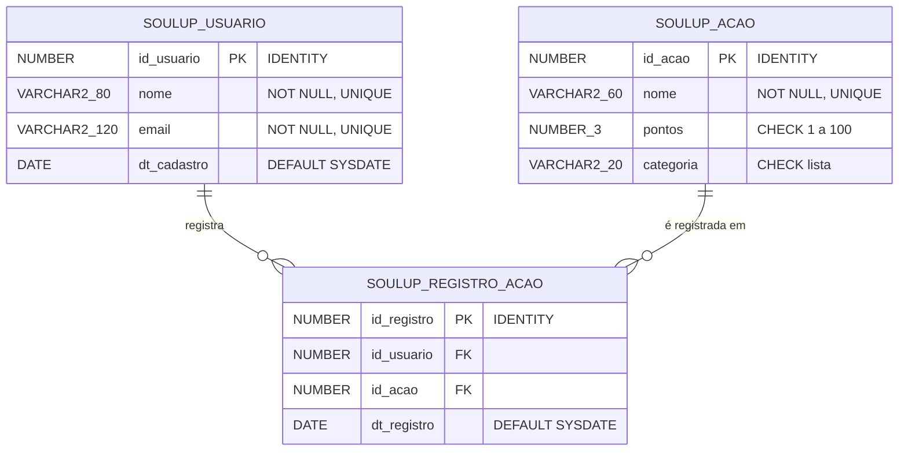
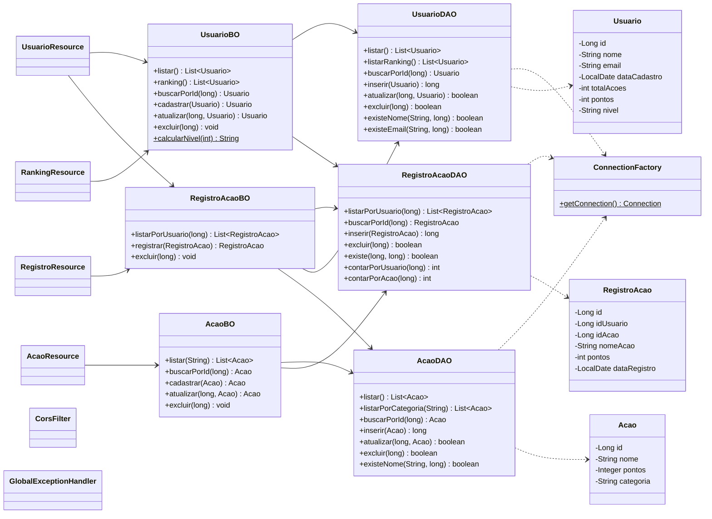

# SoulUp – Documentação da API Java

<!-- CAPA (para o PDF) -->
**Challenge FIAP 2026 · SoulUp**
**Disciplina:** Domain Driven Design Using Java · Sprint 4
**Equipe:** SoulPoints
**Solução:** SoulUp, uma plataforma de gamificação sustentável

| Integrante | RM |
|---|---|
| Cauã De Souza Vasconcellos | RM573349 |
| Gabriel Tavares | RM571113 |
| Leonardo De Souza Bernard | RM570951 |
| Luigi Tormim Carqueijeiro | RM572424 |

**Repositório:** https://github.com/LuigiT2703/soulup-api
**Deploy da API:** `https://SEU-SERVICO.onrender.com` _(atualizar)_
**Front-end:** `https://SEU-FRONT.vercel.app` _(atualizar)_

---

## 1. Objetivo e escopo
O SoulUp incentiva hábitos sustentáveis com gamificação. O usuário registra ações sustentáveis (usar transporte público, reciclar, plantar árvore...). Cada ação vale pontos, e esses pontos definem o nível do usuário e a posição dele no ranking.

Esta API RESTful em Java/Spring Boot é o back-end do front-end React. Ela cuida de:
- cadastro de usuários e do catálogo de ações sustentáveis (CRUD completo);
- registro das ações feitas por cada usuário;
- cálculo da pontuação, do nível e do ranking.

**Fora do escopo:** login e autenticação, upload de imagens e o chatbot (que fica em outra disciplina).

## 2. Funcionalidades
- **Usuários:** listar, buscar por id, cadastrar, atualizar, excluir e ver o histórico de ações.
- **Ações:** listar (com filtro por categoria), buscar, cadastrar, atualizar e excluir.
- **Registros:** registrar que um usuário fez uma ação e desfazer o registro.
- **Ranking:** usuários ordenados por pontos, do maior pro menor.
- **Regras de negócio:**
  - A pontuação é calculada na hora (`LEFT JOIN` + `SUM`), não fica salva.
  - Nível: ≥80 Guardião da Terra · ≥60 Eco Herói · ≥40 Consciência Verde · ≥20 Aprendiz Sustentável · senão Iniciante.
  - A mesma ação não pode ser registrada duas vezes pelo mesmo usuário.
  - Não dá pra excluir usuário com registros nem ação que já foi registrada.
- **Validações:** nome com 3 a 80 letras; e-mail válido de até 120 caracteres; nome e e-mail únicos; pontos de 1 a 100; categoria da lista.
- **Tratamento de erros:** respostas padronizadas `{status, mensagem}` com 400/404/409/500. Os erros do Oracle são convertidos em status HTTP (ORA-00001 → 409, ORA-02291 → 404, ORA-02292 → 409, ORA-02290 → 400).
- **CORS:** liberado para o front local (`http://localhost:5173`) e para o publicado (`FRONT_URL`).

## 3. Endpoints
Base: `https://SEU-SERVICO.onrender.com`. JSON em camelCase, datas `AAAA-MM-DD`.

| # | Verbo | URI | Corpo (JSON) | Sucesso | Erros possíveis |
|---|---|---|---|---|---|
| 1 | GET | `/usuarios` | - | 200 OK | 500 |
| 2 | GET | `/usuarios/{id}` | - | 200 OK | 404 |
| 3 | POST | `/usuarios` | `{nome, email}` | 201 Created | 400, 409 |
| 4 | PUT | `/usuarios/{id}` | `{nome, email}` | 200 OK | 400, 404, 409 |
| 5 | DELETE | `/usuarios/{id}` | - | 204 No Content | 404, 409 (possui registros) |
| 6 | GET | `/usuarios/{id}/registros` | - | 200 OK | 404 |
| 7 | GET | `/acoes` · `/acoes?categoria=AGUA` | - | 200 OK | 400 (categoria inválida) |
| 8 | GET | `/acoes/{id}` | - | 200 OK | 404 |
| 9 | POST | `/acoes` | `{nome, pontos, categoria}` | 201 Created | 400, 409 |
| 10 | PUT | `/acoes/{id}` | `{nome, pontos, categoria}` | 200 OK | 400, 404, 409 |
| 11 | DELETE | `/acoes/{id}` | - | 204 No Content | 404, 409 (já registrada) |
| 12 | POST | `/registros` | `{idUsuario, idAcao}` | 201 Created | 400, 404, 409 (já registrada) |
| 13 | DELETE | `/registros/{id}` | - | 204 No Content | 404 |
| 14 | GET | `/ranking` | - | 200 OK | 500 |

Qualquer endpoint também pode devolver **500** se o banco estiver fora do ar.

**Exemplos de resposta**
```json
// Usuário
{ "id": 1, "nome": "Ana Silva", "email": "ana@email.com", "dataCadastro": "2026-10-29",
  "totalAcoes": 6, "pontos": 87, "nivel": "Guardião da Terra" }
// Ação
{ "id": 1, "nome": "Usar transporte publico", "pontos": 15, "categoria": "MOBILIDADE" }
// Registro
{ "id": 1, "idUsuario": 1, "idAcao": 1, "nomeAcao": "Usar transporte publico", "pontos": 15, "dataRegistro": "2026-10-29" }
// Erro
{ "status": 404, "mensagem": "Usuário não encontrado" }
```

## 4. MER

`SOULUP_REGISTRO_ACAO` tem `UNIQUE (id_usuario, id_acao)`, então o mesmo usuário não registra a mesma ação duas vezes.

## 5. Diagrama de classes

Exceções: `NaoEncontradoException` (404), `ValidacaoException` (400) e `ConflitoException` (409), todas filhas de `RuntimeException`. O `GlobalExceptionHandler` (`@RestControllerAdvice`) transforma elas, e também as `SQLException`, em `ErroResposta {status, mensagem}`.

> Dica pro PDF: cole o bloco Mermaid em https://mermaid.live e exporte como PNG/SVG.

## 6. Como rodar
**Ferramentas:** IntelliJ IDEA, JDK 21, Maven (já vem no IntelliJ), Git e acesso ao Oracle da FIAP.

1. Clonar: `git clone https://github.com/LuigiT2703/soulup-api.git`
2. Criar as tabelas: rodar `banco/criar_tabelas.sql` no SQL Developer (F5).
3. Abrir a pasta no IntelliJ (`File > Open`). Ele importa o `pom.xml` sozinho.
4. `File > Project Structure > Project SDK`: escolher o **JDK 21**.
5. `Run > Edit Configurations > SoulupApiApplication > Environment variables`:
   `DB_URL=jdbc:oracle:thin:@oracle.fiap.com.br:1521/ORCL;DB_USER=rmXXXXXX;DB_PASSWORD=suaSenha`
6. Rodar `SoulupApiApplication`. A API sobe em `http://localhost:8080`.
7. Testar com o `requests.http` (IntelliJ) ou com o Postman.

**Deploy no Render:** Web Service → Runtime Docker → plano Free → variáveis `DB_URL`, `DB_USER`, `DB_PASSWORD` e `FRONT_URL`. O plano grátis dorme quando fica sem uso, então a primeira requisição leva uns 50 s.

## 7. Telas do front-end integradas
_(Colar aqui os prints das telas reais do front consumindo a API)_

| Tela | Print |
|---|---|
| Lista de usuários / ranking | _print_ |
| Cadastro de usuário | _print_ |
| Catálogo de ações (filtro por categoria) | _print_ |
| Registro de ação / histórico do usuário | _print_ |
| Mensagem de erro (ex.: ação já registrada) | _print_ |

## 8. Uso de IA
**Ferramenta:** Claude Code (Anthropic), usado no terminal integrado ao projeto.

**Prompt usado (resumo):** "Criar do zero a API RESTful em Java (Spring Boot) do SoulUp... Java 21, Spring Boot 3, só starter-web + ojdbc11, sem JPA: DAO com JDBC + ConnectionFactory e PreparedStatement; pacotes model/dao/bo/resource/exception/config; tabelas SOULUP_*; contrato JSON fixo pro front; CorsFilter; erros ORA convertidos em HTTP; deploy no Render com Dockerfile; credenciais só por variável de ambiente." O prompt completo fica no vault da equipe (`Prompt Sprint 4 Java API`).

**O que a IA gerou:**
- a estrutura do projeto Maven, o `pom.xml` e o Dockerfile;
- as classes de model, DAO, BO, resource, exception e config;
- o `requests.http` e o rascunho do README e desta documentação.

**O que foi conferido/corrigido pela equipe:**
- _(preencher: ex. ajustes nas mensagens de erro, nos dados de teste, nas validações...)_
- Os dados de teste do `requests.http` foram trocados porque o e-mail de exemplo já existia no script do banco (dava 409 em vez de 201).

**Decisões da equipe:**
- Usar JDBC puro em vez de JPA, para treinar o padrão DAO visto em aula.
- Não salvar a pontuação no banco: ela é calculada na consulta, assim nunca fica desatualizada.
- Validar no BO **e** manter as constraints no Oracle (dupla proteção): o BO dá mensagens claras e o banco garante a integridade.
- Usar o mesmo banco e as mesmas tabelas do projeto Python, para as disciplinas ficarem integradas.
- Render no plano grátis (sabendo que ele dorme), por ser gratuito e aceitar Docker.
